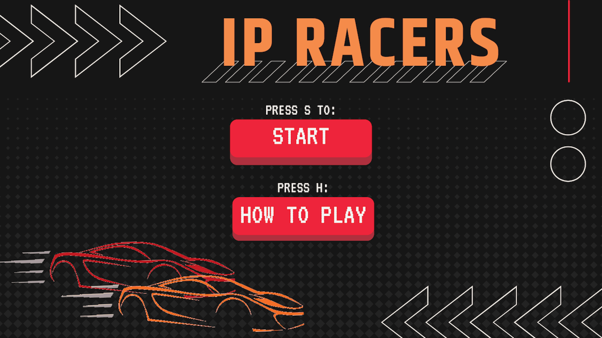
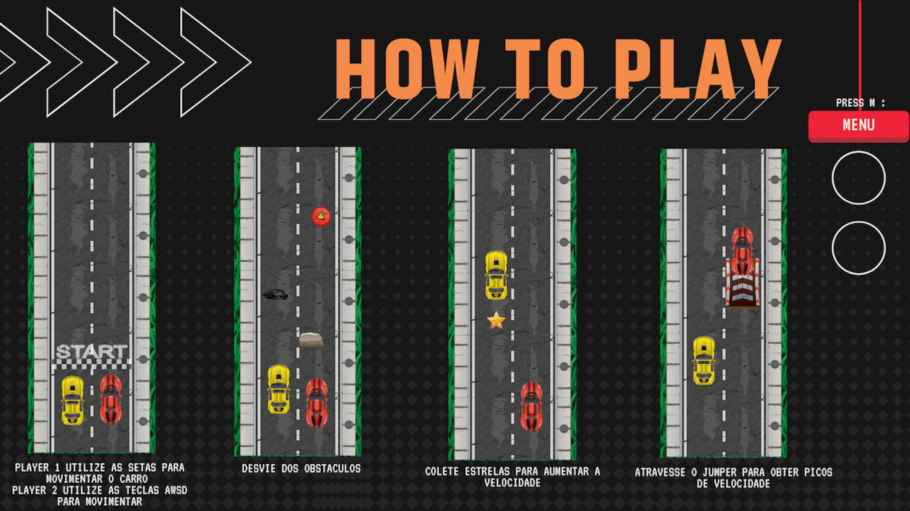
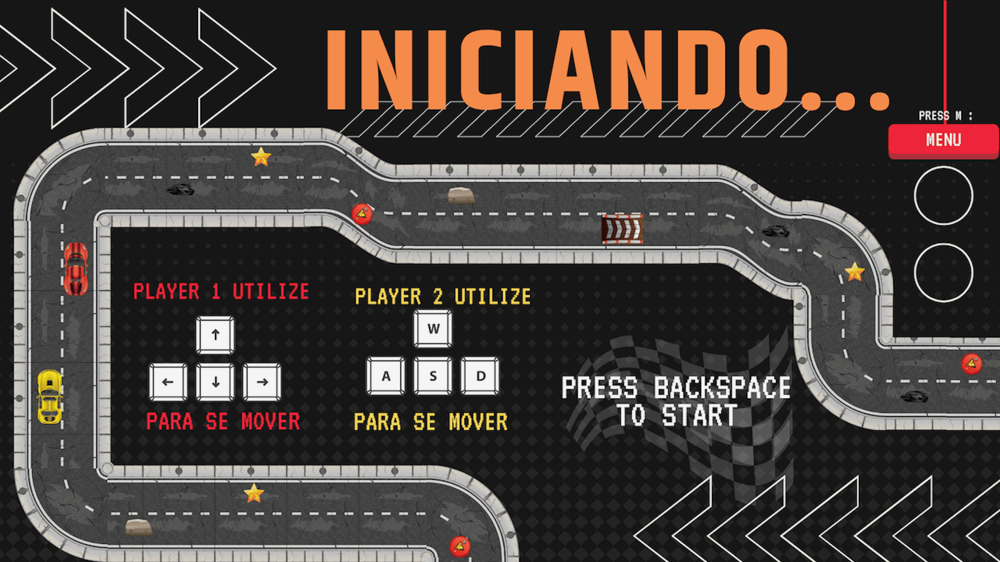
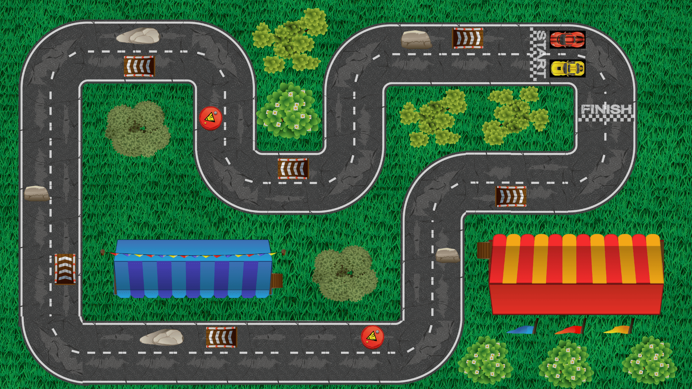
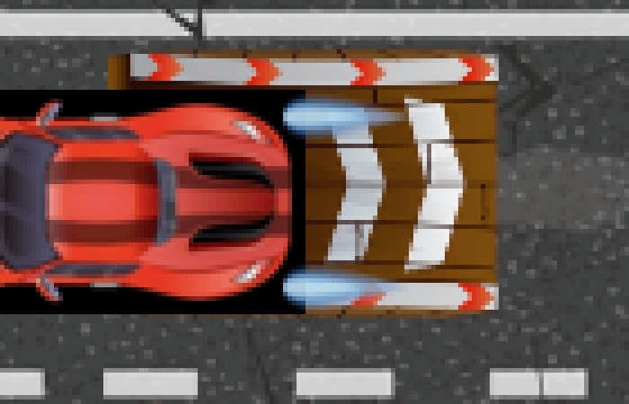
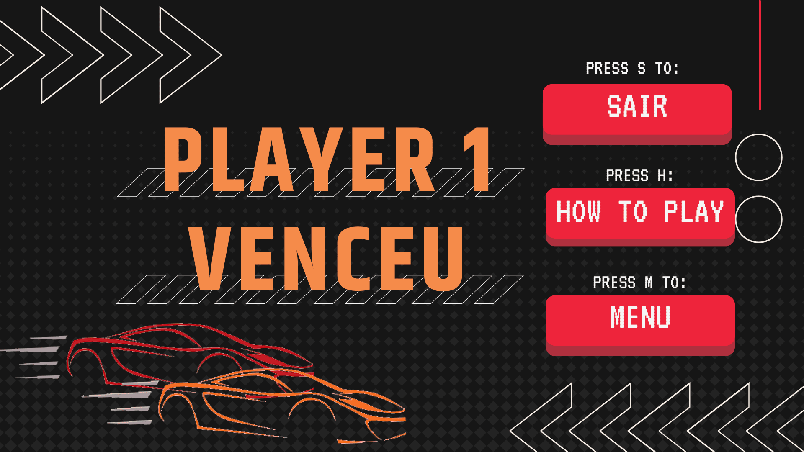

# IP Racers

Jogo de corrida para dois jogadores, escrito em C com a raylib.

## Sobre

Trabalho do primeiro período (2022.1) da disciplina Introdução à Programação, no Centro de Informática da UFPE (CIn-UFPE). A equipe escreveu o código sem ferramentas de IA.

Os dois carros correm na mesma pista. Quem chega primeiro na linha de chegada vê a tela de vitória. No caminho tem moeda e jumper: o jumper liga o nitro por dois segundos e o carro anda mais rápido.

## Prints

As imagens foram tiradas com o jogo aberto.









O carro vermelho passou pelo jumper. Na foto inteira o rastro é pequeno; o recorte ampliado mostra o nitro azul atrás do carro.






## Controles

| Tecla | O que faz |
| --- | --- |
| S | No menu, começa. Na tela final, sai. |
| H | Abre o como jogar. |
| M | Volta ao menu. |
| Backspace | Sai da tela de início e entra na pista. |
| Esc | Sai da partida. |
| Setas | Movem o jogador 1. |
| W, A, S, D | Movem o jogador 2. |

## Como compilar e rodar

No Linux, a partir da pasta do projeto. O `make` compila só o `main.c` e liga com a raylib instalada em `/usr/local`, ou com o que o `pkg-config` achar. A raylib 5.5 não está no apt do Ubuntu 24.04, então o caminho abaixo compila ela na mão.

Dependências:

```bash
sudo apt install build-essential git \
  libgl1-mesa-dev libglu1-mesa-dev libx11-dev libxrandr-dev \
  libxinerama-dev libxcursor-dev libxi-dev libxext-dev libasound2-dev
```

Raylib:

```bash
git clone --depth 1 --branch 5.5 https://github.com/raysan5/raylib.git
cd raylib/src
make PLATFORM=PLATFORM_DESKTOP
sudo make install PLATFORM=PLATFORM_DESKTOP
```

Jogo:

```bash
make
./Jogo
```

Os mp3 ficam na raiz do repositório e as imagens em `assets/images/`. A janela abre em 1920x1080, que é o tamanho da arte. Sem placa de som o jogo abre igual e só fica sem áudio.

## Estrutura do código

Os headers incluem os `.c` correspondentes. Por isso, no Linux, o `make` não compila cada arquivo separado.

| Arquivo | Função |
| --- | --- |
| `main.c` | Abre a janela, carrega imagem e som, e troca de tela. |
| `menu.c` | Menu, como jogar e tela de início. |
| `personagem.c` | Movimento, colisão, moeda e nitro. |
| `mapa.c` | Barreiras, moedas, jumpers e linha de chegada. |
| `animacao.c` | Tempo do nitro e desenho do carro. |
| `fimDoJogo.c` | Tela de quem ganhou. |
| `assets/images/` | Pista, carros e telas. |
| `*.mp3` | Som do menu, da pista, do nitro, da moeda, da batida e da vitória. |

## Equipe

| Nome | GitHub |
| --- | --- |
| Ian Melo | [iianmelo](https://github.com/iianmelo) |
| Alice Buarque Cadete | [alicecadete28](https://github.com/alicecadete28) |
| Luisa Leiria | [luisaleiria](https://github.com/luisaleiria) |
| YMendes27 | [YMendes27](https://github.com/YMendes27) |
| OIcaroMelo | [OIcaroMelo](https://github.com/OIcaroMelo) |
